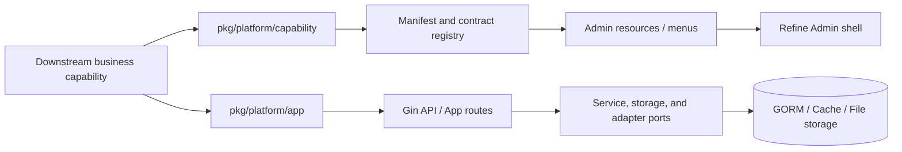

# platform-go

> A business-neutral platform foundation for Go services. Keep reusable mechanisms in the platform layer through capability contracts, identity and access, resource schemas, and runtime governance. Keep domain behavior downstream.

[](https://github.com/GnosiST/platform-go/actions/workflows/ci.yml)
[](https://github.com/GnosiST/platform-go/releases/tag/v0.1.0)
[](LICENSE)
[](go.mod)

[Documentation](https://gnosist.github.io/platform-go/en/) · [Five-minute start](https://gnosist.github.io/platform-go/en/docs/getting-started) · [Integrate a capability](https://gnosist.github.io/platform-go/en/docs/business-integration) · [Release](https://github.com/GnosiST/platform-go/releases/tag/v0.1.0) · [简体中文](README.md)

<p align="center">
  
</p>

## Why platform-go

Business systems repeatedly need the same mechanisms: identity, sessions, RBAC, organizational scope, resource management, audit, file handling, contracts, and production preflight. `platform-go` makes those mechanisms composable boundaries without embedding orders, customers, menus, workflows, or domain data in core.

It fits teams building long-running Go services that want Admin and backend contracts to move together while preserving production security and migration boundaries. It is not a turnkey vertical product, nor a runtime marketplace for downloading and hot-installing arbitrary business plugins.

| What you get | Core constraint |
| --- | --- |
| Gin + GORM service foundation and Refine + Ant Design Admin | Business packages do not import `internal/platform/**` |
| Capability manifests, resource schemas, OpenAPI, and codegen previews | Menus are visibility hints; Casbin authorization is the security boundary |
| JWT plus server-side revocation, tenant/org/RBAC, audit, and lifecycle | The default supports one datasource and one native transaction boundary |
| Redis cache port, file storage, production preflight, and release evidence | Optional integrations are explicitly composed and take effect after restart |

## Five-minute start

Prerequisites: Go 1.26+, Node.js, and npm. These commands use development defaults; SQLite is for development and tests only. Production needs independent durable stores and Redis.

```bash
git clone https://github.com/GnosiST/platform-go.git
cd platform-go

npm --prefix admin install
go run ./cmd/platform-api
```

Start Admin in another terminal:

```bash
npm --prefix admin run dev
```

Verify the API and UI:

```bash
curl -fsS http://127.0.0.1:9200/api/health
# Expected: includes "ok":true
```

Open [http://127.0.0.1:9202](http://127.0.0.1:9202). Demo/OIDC flows are for local shell validation only. Do not promote a demo provider, development keys, or SQLite configuration to production. See the complete [getting started guide](https://gnosist.github.io/platform-go/en/docs/getting-started) for success criteria and troubleshooting.

## Architecture: platform mechanisms, downstream domains



Downstream code declares capabilities, resources, permissions, routes, and lifecycle through public packages. Concrete handlers, stores, Admin interactions, and domain tests stay in a downstream composition root. Platform core never imports an application package.

## Integrate your first business capability

Begin with [`examples/external-capability`](examples/external-capability), not with a change to `internal/platform/**`:

```go
import "github.com/GnosiST/platform-go/pkg/platform/capability"

func Manifest() capability.Manifest {
    return capability.Manifest{
        ID: "inventory",
        // Declare resources, permissions, routes, and lifecycle.
    }
}
```

1. Copy the example and import only `pkg/platform/capability` and necessary public App contracts.
2. Declare resource schemas, menus, permissions, routes, service contracts, and lifecycle in the manifest.
3. Inject storage, HTTP handlers, Admin actions, and business UI from a downstream composition root.
4. Generate contracts and run the external-capability gate.
5. Review migrations, rollback, and domain tests as downstream deliverables.

```bash
node scripts/validate-external-capability-example.mjs
```

The full tutorial includes a composition root and acceptance checklist: [business integration](https://gnosist.github.io/platform-go/en/docs/business-integration).

## Support boundary

| State | Scope | Meaning |
| --- | --- | --- |
| Default | Identity, sessions, RBAC, organization, resources, audit, files, one datasource | Suitable for the normal business-service baseline |
| Explicit profile | Personnel, notification, jobs, enterprise governance, Admin OIDC, credential auth | Compose through manifest/profile; regenerate contracts and restart |
| Default-off | Datasource registry, read/write routing, sharding, read-only federation, XA, Outbox/RabbitMQ, search projection | Contracts are implemented but need a downstream composition root, controlled environment, and promotion evidence |
| Unsupported | Oracle, KingbaseES, runtime hot-plugging, remote source download, generic destructive uninstall | Do not assume availability in product or deployment commitments |

The current governance snapshot is **67 total / 67 implemented / 0 controlled unfinished**. `open-source-portability`, `public-docs-community`, `public-docs-site`, and `github-release-publication` are `implemented`. An implemented controlled contract is not the same as default production enablement, especially for multi-datasource, message, and search integrations. See the [support matrix](https://gnosist.github.io/platform-go/en/docs/support-matrix).

<details>
<summary>Release compatibility record</summary>

The persistent full-scope task graph is implemented. The default release retains one datasource and one native transaction boundary. SQLite is development/test-only by support policy; Oracle and KingbaseES are unsupported. `alibaba/page-agent` is only a default-off optional `public-docs-site` sub-capability.

</details>

## Authentication and production

- `credential-auth` provides provider discovery, Argon2id, a dedicated GORM repository, application-layer encrypted secret transport, mandatory challenges, and SMS OTP contracts. Passwords, OTPs, challenge proofs, and raw identifiers never enter generic resource fields.
- Login modes are discovered from `GET /api/auth/providers`; clients must not hard-code all providers or render debug verification codes.
- Production requires independent keys, durable Admin/session/lifecycle stores, Redis, a trusted HTTPS edge, and `PLATFORM_DISABLE_DEMO_AUTH_PROVIDER=true`.
- Key rotation, database migration, backup recovery, external SMS delivery, message, and search promotion each require review, rollback, and redacted evidence.

Start with [authentication and authorization](https://gnosist.github.io/platform-go/en/docs/authentication) and complete the [production checklist](https://gnosist.github.io/platform-go/en/docs/production-checklist) before launch.

## Policy review

Policy changes enter production through a reviewed workflow; there is no generic bypass endpoint:

```text
POST /api/admin/policy-reviews/:id/request
POST /api/admin/policy-reviews/:id/reject
POST /api/admin/policy-reviews/:id/approve
GET /api/admin/policy-reviews/export
```

## Documentation by task

| Goal | Entry point |
| --- | --- |
| Run locally and diagnose issues | [Getting started](https://gnosist.github.io/platform-go/en/docs/getting-started) · [Operations](https://gnosist.github.io/platform-go/en/docs/operations) |
| Understand boundaries and capability model | [Architecture](https://gnosist.github.io/platform-go/en/docs/architecture) · [Capabilities](https://gnosist.github.io/platform-go/en/docs/capabilities) · [Support matrix](https://gnosist.github.io/platform-go/en/docs/support-matrix) |
| Integrate a domain | [Business integration](https://gnosist.github.io/platform-go/en/docs/business-integration) · [Admin and resources](https://gnosist.github.io/platform-go/en/docs/development) |
| Add authentication | [Authentication](https://gnosist.github.io/platform-go/en/docs/authentication) · [API and contracts](https://gnosist.github.io/platform-go/en/docs/api) |
| Run in production | [Deployment](https://gnosist.github.io/platform-go/en/docs/deployment) · [Production checklist](https://gnosist.github.io/platform-go/en/docs/production-checklist) · [Operations](https://gnosist.github.io/platform-go/en/docs/operations) |
| Contribute and govern | [Human + AI development protocol](https://gnosist.github.io/platform-go/en/docs/human-ai-development) · [Security](https://gnosist.github.io/platform-go/en/docs/security) |

## Version, contribution, and license

v0.1.0 is formally published; see the [GitHub Release](https://github.com/GnosiST/platform-go/releases/tag/v0.1.0). Production consumers should pin a Git commit SHA that passed the repository's test and contract gates, rather than following mutable `main`. New capabilities include their manifest, contracts, tests, documentation, and when applicable migration and rollback evidence.

Read [CONTRIBUTING.md](CONTRIBUTING.md) before opening an issue or pull request. Licensed under [Apache License 2.0](LICENSE).
