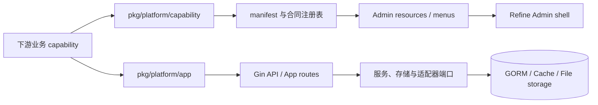

# platform-go

> 面向 Go 服务的业务中立平台底座。用能力合同、身份与授权、资源 schema 和运行治理，把可复用机制留在平台层，把业务留在下游。

[](https://github.com/GnosiST/platform-go/actions/workflows/ci.yml)
[](https://github.com/GnosiST/platform-go/releases/tag/v0.1.0)
[](LICENSE)
[](go.mod)

[文档站](https://gnosist.github.io/platform-go/) · [五分钟开始](https://gnosist.github.io/platform-go/docs/getting-started) · [接入业务能力](https://gnosist.github.io/platform-go/docs/business-integration) · [发行版本](https://github.com/GnosiST/platform-go/releases/tag/v0.1.0) · [English](README.en.md)

<p align="center">
  
</p>

## 为什么是 platform-go

业务系统通常需要同一组底层机制：身份、会话、RBAC、组织范围、资源管理、审计、文件、合同和生产预检。`platform-go` 把这些机制做成可组合的能力边界，而不把订单、客户、菜单、工作流或领域数据写进核心。

适合正在构建长期运行 Go 服务、希望让后端与 Admin 合同同步、并需要保留生产安全与迁移边界的团队。不适合把它当作开箱即用的垂直行业系统，或在运行时下载和热安装任意业务插件。

| 你得到什么 | 核心约束 |
| --- | --- |
| Gin + GORM 服务底座，Refine + Ant Design Admin | 业务包不依赖 `internal/platform/**` |
| capability manifest、资源 schema、OpenAPI 与代码生成预览 | 菜单只表示可见性，Casbin 后端授权才是安全边界 |
| JWT + 服务端会话撤销、租户/组织/RBAC、审计与生命周期 | 默认仅支持一个数据源和一个原生事务边界 |
| Redis 缓存端口、文件存储、生产预检与发布证据 | 可选集成必须显式组合，并在重启后生效 |

## 五分钟跑通

前置条件：Go 1.26+、Node.js 和 npm。下面命令使用开发默认值；SQLite 仅限开发和测试，生产环境需要独立的持久化存储和 Redis。

```bash
git clone https://github.com/GnosiST/platform-go.git
cd platform-go

npm --prefix admin install
go run ./cmd/platform-api
```

在另一个终端启动 Admin：

```bash
npm --prefix admin run dev
```

验证 API 与界面：

```bash
curl -fsS http://127.0.0.1:9200/api/health
# 预期包含: "ok":true
```

打开 [http://127.0.0.1:9202](http://127.0.0.1:9202)。本地可使用 demo/OIDC 流程进行壳层验证；不要把 demo provider、开发密钥或 SQLite 配置带入生产。完整步骤、常见问题和成功标准见[快速开始](https://gnosist.github.io/platform-go/docs/getting-started)。

## 架构：平台提供机制，业务提供领域



下游业务只通过公开包声明 capability、资源、权限、路由和生命周期；具体 handler、存储、Admin 交互和领域测试留在下游 composition root。平台核心不反向导入业务包。

## 接入第一个业务能力

从仓库的 [`examples/external-capability`](examples/external-capability) 开始，而不是修改 `internal/platform/**`：

```go
import "github.com/GnosiST/platform-go/pkg/platform/capability"

func Manifest() capability.Manifest {
    return capability.Manifest{
        ID: "inventory",
        // 声明资源、权限、路由与生命周期；具体实现留在下游。
    }
}
```

1. 复制示例并只导入 `pkg/platform/capability` 和需要的公开 App 合同。
2. 在 manifest 中声明资源 schema、菜单、权限、路由、服务合同和生命周期。
3. 在下游 composition root 注入 storage、HTTP handler、Admin action 和业务 UI。
4. 生成合同并运行外部能力门禁。
5. 把迁移、回滚和业务测试作为下游交付物一起审阅。

```bash
node scripts/validate-external-capability-example.mjs
```

完整教程包括可复制的 composition root 与验收清单：[业务能力接入](https://gnosist.github.io/platform-go/docs/business-integration)。

## 支持边界

| 状态 | 范围 | 说明 |
| --- | --- | --- |
| 默认支持 | 身份、会话、RBAC、组织、资源、审计、文件、单数据源 | 适合作为常规业务服务基础 |
| 显式 profile | 人员、通知、任务、企业治理、Admin OIDC、credential-auth | 通过 manifest/profile 组合，合同重生成后重启生效 |
| default-off | 数据源注册、读写路由、分片、联邦只读、XA、Outbox/RabbitMQ、搜索投影 | 合同已实现，但需要下游组合根、受控环境和推广证据 |
| 未支持 | Oracle、KingbaseES、运行时热插拔、远程拉取源码、通用破坏性卸载 | 不应在产品承诺或部署方案中假设可用 |

当前治理快照为 **67 total / 67 implemented / 0 controlled unfinished**。`open-source-portability`、`public-docs-community`、`public-docs-site` 和 `github-release-publication` 均为 `implemented`。实现受控合同不等于默认生产启用，尤其是多数据源、消息与搜索集成仍需要单独的环境与外部证据包。详见[支持矩阵](https://gnosist.github.io/platform-go/docs/support-matrix)。

<details>
<summary>发布兼容性记录</summary>

The persistent full-scope task graph is implemented. The default release retains one datasource and one native transaction boundary. SQLite is development/test-only by support policy; Oracle and KingbaseES are unsupported. `alibaba/page-agent` is only a default-off optional `public-docs-site` sub-capability.

</details>

## 认证与生产

- `credential-auth` 提供 provider discovery、Argon2id、专用 GORM 仓储、应用层加密 secret transport、mandatory challenge 和 SMS OTP 合同。密码、OTP、挑战答案与原始标识不会进入通用资源字段。
- 登录方式由 `GET /api/auth/providers` 发现；客户端不得硬编码全部提供方，也不得显示开发调试验证码。
- 生产需要独立密钥、持久化 Admin/session/lifecycle 存储、Redis、可信 HTTPS 边缘和 `PLATFORM_DISABLE_DEMO_AUTH_PROVIDER=true`。
- 密钥轮换、数据库迁移、备份恢复、外部短信投递、消息和搜索推广都必须有审阅、回滚与红脱敏证据。

从[认证与授权](https://gnosist.github.io/platform-go/docs/authentication)开始；上线前逐项完成[生产检查清单](https://gnosist.github.io/platform-go/docs/production-checklist)。

## 策略评审

策略变更通过受审阅的工作流进入生产，不提供通用绕过入口：

```text
POST /api/admin/policy-reviews/:id/request
POST /api/admin/policy-reviews/:id/reject
POST /api/admin/policy-reviews/:id/approve
GET /api/admin/policy-reviews/export
```

## 文档按任务阅读

| 目标 | 入口 |
| --- | --- |
| 本地运行与排错 | [快速开始](https://gnosist.github.io/platform-go/docs/getting-started) · [故障排查](https://gnosist.github.io/platform-go/docs/operations) |
| 了解边界与能力模型 | [架构](https://gnosist.github.io/platform-go/docs/architecture) · [能力与扩展](https://gnosist.github.io/platform-go/docs/capabilities) · [支持矩阵](https://gnosist.github.io/platform-go/docs/support-matrix) |
| 接入业务 | [业务能力接入](https://gnosist.github.io/platform-go/docs/business-integration) · [Admin 与资源](https://gnosist.github.io/platform-go/docs/development) |
| 接入认证 | [认证与授权](https://gnosist.github.io/platform-go/docs/authentication) · [API 与合同](https://gnosist.github.io/platform-go/docs/api) |
| 生产运行 | [部署](https://gnosist.github.io/platform-go/docs/deployment) · [生产检查](https://gnosist.github.io/platform-go/docs/production-checklist) · [运维](https://gnosist.github.io/platform-go/docs/operations) |
| 贡献与治理 | [人机协同开发协议](https://gnosist.github.io/platform-go/docs/human-ai-development) · [安全边界](https://gnosist.github.io/platform-go/docs/security) |

## 版本、贡献与许可

v0.1.0 已正式发布，发行说明见 [GitHub Release](https://github.com/GnosiST/platform-go/releases/tag/v0.1.0)。下游生产接入应固定经测试和合同门禁验证的 Git commit SHA，而不是依赖可变的 `main`。新能力需要同时提交 manifest、合同、测试、文档，以及需要时的迁移和回滚证据。

阅读[贡献指南](CONTRIBUTING.md)后再提交 issue 或 pull request。项目采用 [Apache License 2.0](LICENSE)。
